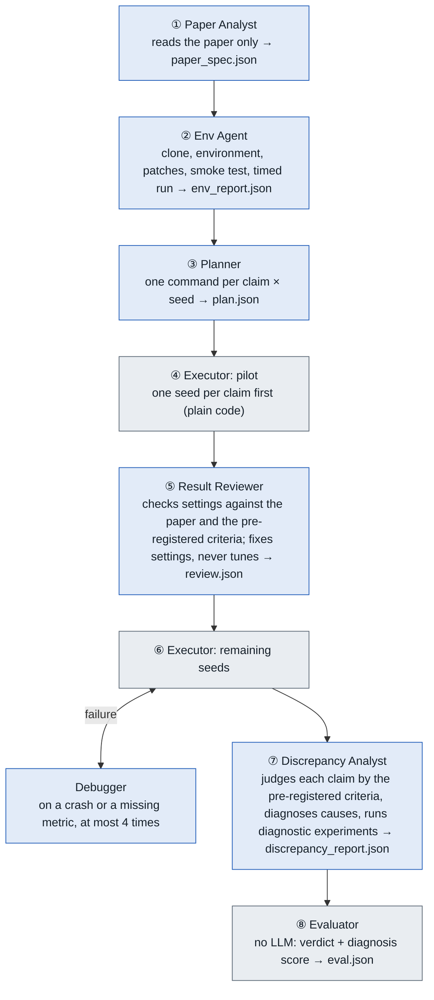
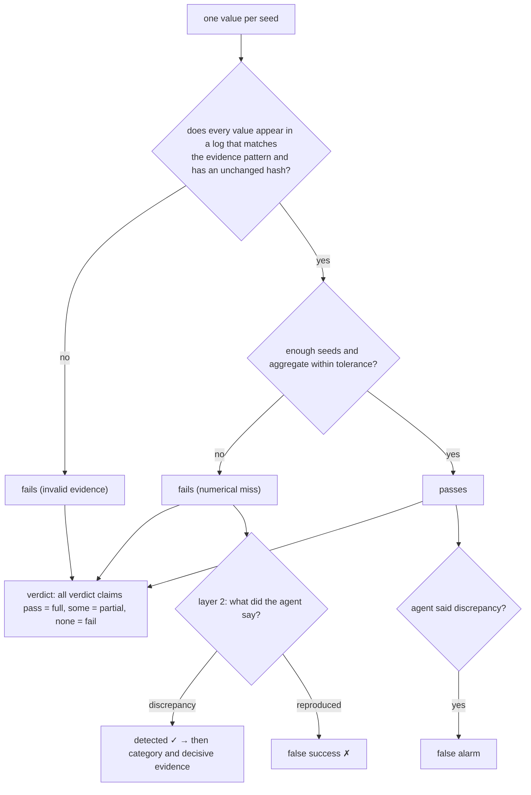
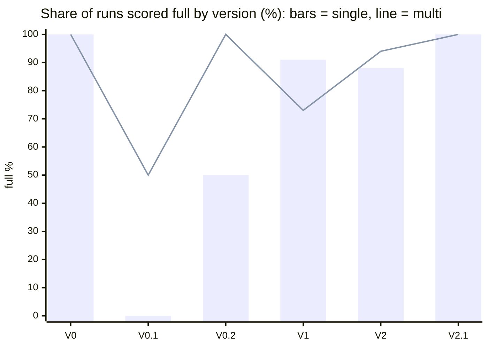

# Paper2Experiment Project Overview

As of 2026-10-07 · EE6008 · solo project · MacBook Air M4, 16 GB, CPU only · model OpenAI gpt-6-luna · [中文](OVERVIEW.zh.md)

## 1. What the project is

Paper2Experiment has LLM agents reproduce engineering research papers: given a paper PDF and the authors' official repository, an agent clones the code into an isolated workspace, sets up the environment, fixes what breaks, runs the experiments with the paper's settings and submits the numbers it measured; when a number cannot be reproduced it has to say why. An **evaluator that uses no LLM** then scores the run against hidden ground truth: the first layer checks the numbers, the second checks the agent's explanation of any failure.

| Approach | Who does the work | Purpose |
|---|---|---|
| Deterministic | No LLM: clone, install from requirements, run the README command, regex the metric | Control group; shows that "just follow the README" does not work |
| Single-agent | One agent with all tools does everything and submits numbers and a diagnosis | The simplest LLM design |
| Multi-agent | Six roles; numbers are parsed from executor logs only | Tests whether the division of labour gives steadier, deeper reproductions |

Scale: 8 papers (6 run through the AI workflows; L2O and PINN keep only their manual reproductions because training is too slow); 66 AI runs plus 3 deterministic controls; about $2.3 spent in total; about 1,765 lines of code and 35 tests. Repository: https://github.com/kokundesu/Paper2Experiment

## 2. Architecture

Three parts: the **benchmark** (`benchmark/`, papers and ground truth), the **program** (`p2e/`, runs reproductions and scores them) and the **run records** (`runs/`, the evidence each run leaves). Workspaces live outside the project (`~/Library/Caches/p2e/workspaces/`) and are deleted after scoring.

```
benchmark/<case>/   task.yaml   (visible to agents: paper, repo, claim list)
                    case.yaml   (hidden: paper values, tolerances, evidence patterns, cause answers)
                    MANUAL_REPRO.md · DISCREPANCY.md (manual reproduction, cause investigation)
p2e/                schemas.py   data contracts between stages (pydantic)
                    sandbox.py   isolated workspace, timeouts, key scrubbing, command guard, log sha256
                    llm.py       agent loop on the Responses API, tools, budget
                    runner.py    run directory, pre-registered criteria, executor, final scoring
                    evaluator.py two-layer scoring without an LLM
                    workflows/   deterministic · single_agent · multi_agent · shared rules
                    web/         `p2e serve`: local web UI, live stages and event feed of a run, single vs multi comparison
runs/<run>/         trace.jsonl · logs/ · log_manifest.json · metrics.json
                    discrepancy_report.json · eval.json · summary.json
```

Key design decisions:

1. **Ground truth is hidden from agents.** They see only `task.yaml`; the sandbox blocks any command touching `case.yaml`, `benchmark/` or `.env`.
2. **Numbers come only from logs.** Every value must appear in a log that proves training happened (matches the evidence pattern) and whose hash is unchanged; a number printed by hand does not count.
3. **Pre-registered criteria.** The runner writes each claim's tolerance, aggregate and seed count into the task brief, so agents and evaluator use the same yardstick; the target value stays hidden.
4. **Diagnostic-only claims.** Results the manual reproduction showed cannot be reproduced from the released code are marked `diagnostic_only`: measured as usual, excluded from the verdict, used only to test whether the agent can explain the gap.
5. **Hard budget cap.** At most $5 per run, shared by all roles; actual runs cost $0.007–0.09.
6. **Traceability.** Every LLM turn, tool call and full command output stays in `runs/`, so any run can be rescored under new rules.

## 3. Workflows

| | Deterministic | Single-agent | Multi-agent |
|---|---|---|---|
| LLM | none | one agent, all tools | six roles, each with only the tools it needs |
| Who produces the numbers | regex over logs | the agent submits, the evaluator checks the logs | the executor parses logs |
| Settings check | none | the agent itself | Result Reviewer, once |
| Debugging | none | free-form within 80 turns and the budget | Debugger, at most 4 sessions |
| Failure diagnosis | none | submitted with the results | Discrepancy Analyst |
| Reasoning effort | – | medium throughout | review roles high, others medium |

### 3.1 The multi-agent pipeline



Blue boxes are LLM roles, grey boxes plain code. Each role writes its output as JSON and the next role reads only what came before; information flows downstream only, so a settings error found by the Analyst cannot trigger a rerun.

| Role | Tools | Effort | Turn limit | Budget share |
|---|---|---|---|---|
| Paper Analyst | read-only | medium | 20 | 15% |
| Env Agent | read/write + shell | medium | 50 | 40% |
| Planner | read-only | medium | 20 | 15% |
| Result Reviewer | read/write + shell | high | 30 | 15% |
| Debugger (per session) | read/write + shell | medium | 30 | 25% |
| Discrepancy Analyst | read-only + shell | high | 30 | 20% |

### 3.2 Single-agent and deterministic

The single agent has all tools, at most 80 turns, and does everything in one context: reading the paper, cloning, environment, bug fixes, settings check, all seeds, diagnosis. It shares the same settings-check, runtime and diagnosis rules as multi-agent. Its submission must hold one value per seed; fewer are sent back. Deterministic uses no LLM and failed on all three original papers, at exactly the first obstacle the manual reproductions hit (a module removed from SciPy, no entry point, a NumPy 2 error).

### 3.3 Shared rules

| Rule | Content |
|---|---|
| Logs are the evidence | A run's full output must go to its command log; no redirecting or filtering |
| Settings check | On a large gap, first check for deviations from the paper: dataset, split, noise level, metric, unit, repository defaults, shortened training |
| Settings the paper omits | May be inferred from a quantity that needs no training (an analytic or model-driven baseline), stating the basis |
| Paper text vs official command | Measure with the authors' command, run the text setting once as a diagnostic, report both |
| Forbidden | Changing settings the paper states; searching hyperparameters, seeds or noise levels to hit a number |
| Diagnosis checklist | Is a quantity that needs no training also off? Did the code change after publication (test each change alone and combined)? Is the deviation fixed or random? |

## 4. Evaluation and diagnosis scoring



| Diagnosis metric | Definition | What it measures |
|---|---|---|
| Detection | Share of numerically failing claims flagged as "discrepancy" | Did the agent notice the failure |
| False success | A failing claim called "reproduced" | Honesty; the worst error |
| False alarm | A claim within tolerance called "discrepancy" | Over-suspicion |
| Attribution | Category (one of 7) hits the ground truth | Right direction |
| Strict attribution | Category right and decisive evidence mentioned (auto-matched, adjudicated by hand) | Was the mechanism found |

Seven categories: reproducer_error, paper_code_mismatch, underspecified_paper, randomness, environment, paper_error, unknown. "Failing" is numerical only; invalid evidence or too few seeds affect layer 1 alone.

## 5. Guardrails

| Risk | Guardrail | Discovered when |
|---|---|---|
| Peeking at the answer | Only `task.yaml` is given; the sandbox blocks commands touching `case.yaml` or `benchmark/` | By design |
| Submitting a hand-written number | Every value must appear in a log that proves training happened | SGC: the agent printed a hand-written mean and cited it |
| Forging or editing a log | The sandbox keeps the sha256 of every log; the evaluator accepts only unchanged ones | KalmanNet: the agent wrote into the log directory with `tee` |
| Tuning to hit the number | Stated settings may not be changed, no hyperparameter search; diagnostic runs never change the metrics | In 48 formal runs the EKF was never tuned to the paper's value |
| Reaching the API key | The key lives only in `.env`; the sandbox strips key variables and blocks commands reading `.env` | The key once appeared in terminal output |
| Touching the host project | Workspaces outside the project; `UV_NO_PROJECT`, `UV_NO_CONFIG`, `GIT_CEILING_DIRECTORIES` | DGI: the agent's `uv run` wrote `uv.lock` into the project root |

Isolation is by convention and checks, not OS-level; a Docker backend is future work.

## 6. Change log

| Version | Problem found | Change |
|---|---|---|
| **V0** moved to OpenAI; benchmark GCN, DLinear, KalmanNet | Chat Completions on GPT-6 does not allow function calling with reasoning on | Responses API, cost tracked per request |
| | API key appeared in plain text in terminal output and was pasted into `.env.example`, which git does not ignore | `.env` (git-ignored, mode 600); the sandbox blocks commands reading `.env` |
| | L2O and PINN train 7–17 minutes per run, too slow on a MacBook Air | Replaced with minute-scale papers; the two keep only manual reproductions |
| **V0.1** failure diagnosis added | The agent redirected training output to `/tmp`; correct numbers were rejected for lack of evidence | Prompts and tool descriptions state that logs are the only evidence |
| | The agent could write into the log directory (`tee ../logs/…`) and forge evidence | The sandbox hashes its logs; the evaluator accepts only unchanged ones |
| | Empty conclusions, no experiments; right category with wrong reasoning scored full marks | Conclusion required, at least one diagnostic experiment per discrepancy; strict attribution added |
| | Nothing in multi-agent compared results with the paper, so a wrong noise level went unnoticed | Result Reviewer and pilot runs added |
| | Training cut from 4000 to 200 steps without reason; 25 minutes wasted on a hung DataLoader | Time first, then shrink; 120–300 s timeout on first runs |
| **V0.2 → V1** formal v1 (18 runs) | Results within tolerance flagged as discrepancies (5 times) | Rule "within 2–3% relative counts as consistent" added (removed in V2) |
| | The multi-agent Analyst ran no experiments, finishing in 36 s | Review roles moved to high effort |
| | Single-factor experiments over-interpreted: one change without effect ruled out a whole code version | Checklist: test each change alone and combined |
| | Two strict-attribution false positives: the agent mentioned "1/L" to rule it out | Item removed; every automatic hit adjudicated by hand |
| **V2** new cases SGC, FITS; formal v2 (30 runs) | The "2–3%" rule made both workflows call a 0.7 pp Citeseer gap reproduced, against a 0.5 pp tolerance | Global threshold removed; pre-registration: tolerance written into the task brief |
| | No rule for paper text (100 epochs) vs README (150) | Measure with the official command, run the text setting once as a diagnostic |
| | The single agent submitted the mean of 3 seeds as one value | One value per seed; shorter submissions sent back |
| | Hand-written numbers printed with Python passed the evidence check | Every value must appear in a log matching the evidence pattern |
| | Evidence patterns tied to an output format; FITS legitimately changed it and was mis-scored | Patterns match the training trace only; all runs rescored |
| | DLinear multi "found a mechanism" with 3 seeds | Checked with 10 seeds; judged right direction, wrong mechanism |
| **V2.1** new case DGI | The multi-agent run rewrote the log format; the pattern `Loss: ` did not match | Pattern made case-insensitive and format-tolerant |
| | The agent's `uv run` wrote `uv.lock` into the project root and reinstalled the project environment; `git` resolved to the project repository | Workspaces moved outside the project; `UV_NO_PROJECT`, `UV_NO_CONFIG`, `GIT_CEILING_DIRECTORIES`; workspace deleted after scoring |

## 7. Results

All runs were rescored with the current evaluator and case.yaml; the prompts the agents saw differ by version, so changes across versions mix system improvements with random variation.

### 7.1 Across versions

| Version | Runs | single full | multi full | False success / false alarm | min/run (s / m) | $/run (s / m) |
|---|---|---|---|---|---|---|
| V0 | 2 | 1/1 | 1/1 | 0 / 0 | 2.5 / 2.5 | $0.012 / $0.011 |
| V0.1 | 4 | 0/2 | 1/2 | 0 / 0 | 22.5 / 8.2 | $0.024 / $0.040 |
| V0.2 | 4 | 1/2 | 2/2 | 0 / 5 | 13.7 / 13.9 | $0.039 / $0.041 |
| V1 | 22 | 10/11 | 8/11 | 2 / 0 | 12.0 / 13.8 | $0.034 / $0.044 |
| V2 | 32 | 14/16 | 15/16 | 0 / 0 | 11.1 / 15.4 | $0.027 / $0.039 |
| V2.1 | 2 | 1/1 | 1/1 | 0 / 0 | 3.7 / 7.4 | $0.007 / $0.018 |
| Total | 66 | 27/33 | 28/33 | | | |



What changed between versions: V0.1's failures were almost all evaluator and prompt problems (evidence rules, empty conclusions), not agents failing to reproduce; V0.2's five false alarms came from the lack of a stated criterion; V1's two false successes came from the "2–3%" rule failing on SGC; after V2 switched to pre-registration, false successes and false alarms both dropped to zero, making it the only version that is steady on both honesty and success rate.

### 7.2 Single vs multi

| Dimension (V2, 16 runs each) | Single | Multi | Note |
|---|---|---|---|
| Verdict full | 14/16 | 15/16 | the gap comes from KalmanNet only |
| Detection | 12/12 | 11/11 | every failing claim was flagged |
| False success / false alarm | 0 / 0 | 0 / 0 | equally honest |
| Attribution correct | 6/8 | 5/9 | multi better on DLinear, single better on KalmanNet |
| Strict attribution (adjudicated) | 0 | 0.5 | neither finds the real mechanism |
| Mean wall time | 11.1 min | 15.4 min | multi about 1.4× |
| Mean cost | $0.027 | $0.039 | multi about 1.4× |
| LLM requests / tool calls | 29 / 44 | 46 / 76 | multi about 1.6–1.7× |

| Case | V1 single | V1 multi | V2 single | V2 multi |
|---|---|---|---|---|
| GCN | 3/3 | 3/3 | 3/3 | 3/3 |
| DLinear | 3/3 | 3/3 | 3/3 | 3/3 |
| KalmanNet | 3/3 | 1/3 | 1/3 | 2/3 |
| SGC | 0/1 | 0/1 | 4/4 | 4/4 |
| FITS | 1/1 | 1/1 | 3/3 | 3/3 |

Four of the five cases give identical results; the only one that separates the two is one inference step in KalmanNet: the paper states ν = 0 dB but not the absolute noise level. Every run that inferred 1/r² = 20 dB from the KF value (which needs no training) scored full; every run that did not scored fail. Both workflows total 4/8 and the leader flips between versions, so this is sampling noise, not an architectural difference.

| Difference | Single | Multi |
|---|---|---|
| Success rate | 27/33 | 28/33, no steady advantage |
| Cost and time | baseline | steadily about 1.4× more (six roles each reread the paper and code) |
| Time stability | large spread (DLinear ±8.2 min) | stable (±0.9 min): the Env Agent smoke-tests first |
| Diagnosis depth | mostly surface-level | deeper: the Analyst reads git history and runs single-factor experiments |
| Diagnosis accuracy | better on KalmanNet | better on DLinear |
| Structural weakness | no independent review | the Reviewer judges once; the Analyst's findings cannot flow back to trigger a rerun |

Conclusion: on this benchmark multi-agent's value lies in diagnosis depth and run stability, not in success rate, at about 1.4× the cost; the real separation sits in settings inference that needs judgement, where both architectures succeed about half the time.

## 8. Reproduction of each paper

| Paper | Numbers | Paper | Manual | Tolerance | System (single / multi) | Note |
|---|---|---|---|---|---|---|
| GCN (ICLR 2017) | Cora / Citeseer / Pubmed accuracy | 81.5 / 70.3 / 79.0 | 81.76 / 71.15 / 79.08 | ±1.5 pp | V2 3/3 · 3/3 | TF1 code needs `compat.v1` |
| SGC (ICML 2019) | Cora / Citeseer / Pubmed accuracy | 81.0 / 71.9 / 78.9 | 81.02 / 71.84 / 78.95 | ±0.5 pp | V2 4/4 · 4/4 | Citeseer needs the README's 150 epochs |
| DGI (ICLR 2019) | Cora accuracy | 82.3 | none (tolerance set a priori) | ±1.5 pp | V2.1 1/1 · 1/1 | system 82.07 / 81.98 |
| DLinear (AAAI 2023) | four ETT MSEs | 0.375 / 0.439 / 0.289 / 0.299 | 0.374 / 0.447 / 0.294 / 0.301 | ±3–10% | V2 3/3 · 3/3 | diagnostic-only: ETTh1-720 |
| FITS (ICLR 2024) | four ETT MSEs | 0.372 / 0.424 / 0.271 / 0.303 | 0.3721 / 0.4244 / 0.2710 / 0.3029 | ±1% | V2 3/3 · 3/3 | matches to 4 decimals |
| KalmanNet (IEEE TSP 2022) | Table I linear: KalmanNet / KF (dB) | −21.92 / −21.97 | −21.89 / −21.99 | ±0.3 dB | V2 1/3 · 2/3 | noise inferred from the KF; diagnostic-only: Table VI EKF |
| L2O (IEEE TSP 2018) | DNN/WMMSE ratio, speed-up | 98.33 / 92.04 / 84.29 %, 382.6× | 97.88 / 90.61 / 84.86 %, 446× | per claim | not run | training too slow |
| PINN (JCP 2019) | Burgers relative L2 error | 6.7e-4 / 4.9e-4 / 9.4e-4 | 2.6e-3 / 1.1e-3 / 5.1e-3 | 10× | not run | training too slow |

Problems in the papers themselves, found while reproducing:

| Paper | Problem | Evidence | Handling |
|---|---|---|---|
| DLinear | Table 2 comes from the code before the August 2022 update (initialisation and ETTh1 hyperparameters changed) | Old commit `721ab58` matches 12 numbers digit for digit; old code 10-seed median 0.475, current 0.499 | ETTh1-720 diagnostic-only, category paper_code_mismatch |
| KalmanNet | The Table VI EKF row matches a zero-gain filter at all 5 noise levels (within 1.5 dB); against a working EKF only about 1 dB of advantage remains | Paper −4.02 dB, zero-gain −5.5, working EKF −25.1 (at 30 dB) | Diagnostic-only, category paper_error; wording "coincides with a zero-gain filter" |
| SGC | Text says 100 epochs, README uses 150 | Only 150 reproduces (71.84 vs 71.9); 100 gives 71.2 | Conflict rule: official command measures, text setting is a diagnostic |
| FITS | Paper says validation-set selection; the official `_best` configs are test-set optima | A true validation choice is 5.4% worse on ETTh2-96 | Numbers reproduce, verdict unaffected; the system does not check protocols |

## 9. Lessons and limitations

| Lesson | Source |
|---|---|
| Fixing one thing can break another | "2–3%" removed false alarms on DLinear and caused false successes on SGC; the answer is pre-registration, not threshold tuning |
| A number in a log does not mean it came from the experiment | Evidence must be tied to the training trace and independent of the print format (one mis-scoring each on FITS and DGI) |
| Diagnostic experiments with 3 seeds invent mechanisms | DLinear's decoder layer: within tolerance at 3 seeds, unchanged distribution at 10 |
| Reproducing the number is not reproducing the method | FITS selected on the test set; neither workflow noticed |
| In a multi-role pipeline information flows downstream only | KalmanNet: the Analyst found the right noise setting but could not trigger a rerun |

| Limitation | Effect |
|---|---|
| Only 3 repeats per cell | "tends to" wording |
| Unequal effort (multi review roles high, single medium) | part of multi's diagnosis depth may come from thinking more |
| Scoring rules changed three times after seeing results | each documented in case.yaml, all runs rescored |
| Tolerances set after the manual reproductions (except DGI) | they reflect the spread observed by hand |
| Only numbers checked, not protocols; one model; sandbox isolation by convention | results do not generalise; Docker backend is future work |

Optional next steps: an equal-effort control (`P2E_REVIEW_EFFORT=medium`, multi again, about 4 h, $0.6); letting the Analyst's findings trigger one rerun (verify on KalmanNet only); report and demo (due 2026-10-15).

Usage and settings are in `README.md`; `p2e serve` opens the web monitor (live workflow + single vs multi comparison); the three progress briefs are in `docs/`.
