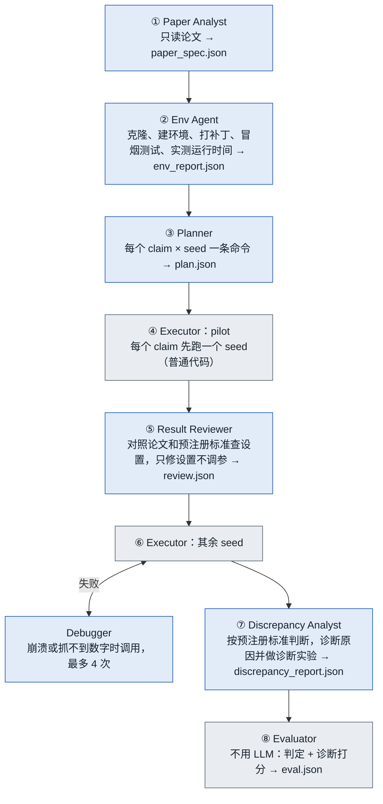
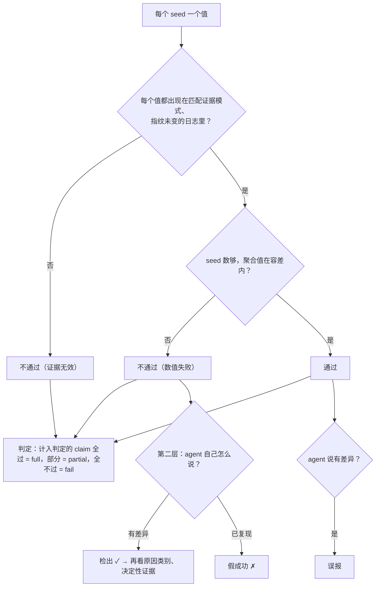
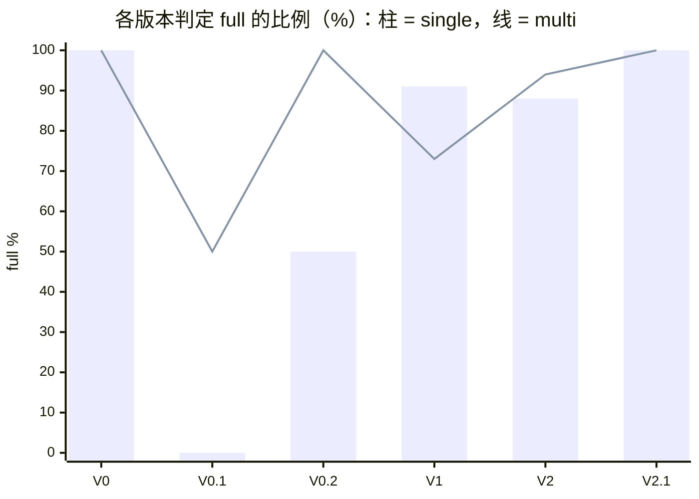

# Paper2Experiment 项目总览

截至 2026-10-07 · EE6008 · 单人项目 · MacBook Air M4，16 GB，仅 CPU · 模型 OpenAI gpt-6-luna · [English](OVERVIEW.en.md)

## 1. 项目简介

Paper2Experiment 让 LLM agent 复现工程类论文：给它论文 PDF 和作者的官方仓库，agent 在隔离的工作目录里克隆代码、搭环境、修 bug、按论文的设置跑实验，交出测到的数字；复现不出来时要说明原因。最后由一个**不用 LLM 的评估器**拿隐藏的标准答案打分：第一层判数字对不对，第二层判 agent 对失败的解释对不对。

| 做法 | 谁在做 | 用途 |
|---|---|---|
| Deterministic | 不用 LLM：克隆、照 requirements 安装、跑 README 里的命令、正则抓数字 | 对照组，证明"照着 README 跑"行不通 |
| Single-agent | 一个 agent 拿着全部工具，从头做到尾，自己提交数字和诊断 | 最简单的 LLM 方案 |
| Multi-agent | 6 个角色分工，数字只从执行器的日志里解析 | 检验分工是否带来更稳、更深的复现 |

规模：8 篇论文（6 篇跑 AI 流程，L2O、PINN 因训练太慢只保留人工复现）；66 次 AI 运行 + 3 次 deterministic 对照；累计花费约 $2.3；代码约 1,765 行，35 个测试。仓库：https://github.com/kokundesu/Paper2Experiment

## 2. 系统架构

项目分三块：**题库**（`benchmark/`，放论文和标准答案）、**程序**（`p2e/`，跑复现和打分）、**运行记录**（`runs/`，每次运行留下的证据）。工作目录在项目外（`~/Library/Caches/p2e/workspaces/`），打完分即删。

```
benchmark/<case>/   task.yaml（agent 可见：论文、仓库、claim 列表）
                    case.yaml（隐藏：论文值、容差、证据模式、原因答案）
                    MANUAL_REPRO.md · DISCREPANCY.md（人工复现与原因调查）
p2e/                schemas.py   各阶段的数据契约（pydantic）
                    sandbox.py   隔离工作目录、超时、删 API key、命令守卫、日志 sha256
                    llm.py       Responses API 上的 agent 循环、工具、预算
                    runner.py    建运行目录、预注册标准、执行器、收尾打分
                    evaluator.py 不用 LLM 的两层打分
                    workflows/   deterministic · single_agent · multi_agent · 共用规则
                    web/         `p2e serve`：本地网页，实时看运行的阶段与事件流，single / multi 对比
runs/<run>/         trace.jsonl · logs/ · log_manifest.json · metrics.json
                    discrepancy_report.json · eval.json · summary.json
```

关键设计决定：

1. **标准答案对 agent 隐藏。** agent 只能看到 `task.yaml`；沙箱拦截任何碰 `case.yaml`、`benchmark/`、`.env` 的命令。
2. **数字只能来自日志。** 每个值必须出现在一份"能证明训练过"（匹配证据模式）、且指纹未变的日志里；手动打印的数字不算。
3. **预注册判定标准。** runner 把每个 claim 的容差、聚合方式和 seed 数写进任务说明，agent 和评估器用同一把尺子；目标值仍隐藏。
4. **仅诊断 claim。** 人工确认用发布代码复现不出来的结论标为 `diagnostic_only`：照常测量，不计入成败，只考 agent 能否说清原因。
5. **预算硬上限。** 每次运行最多 $5，所有角色共用；实际每次 $0.007–0.09。
6. **可追溯。** 每轮对话、每次工具调用、每条命令的完整输出都留在 `runs/`，随时能用新规则重新打分。

## 3. 工作流

| | Deterministic | Single-agent | Multi-agent |
|---|---|---|---|
| LLM | 无 | 一个 agent，全部工具 | 6 个角色，各自只拿需要的工具 |
| 谁产出数字 | 正则抓日志 | agent 提交，评估器核对日志 | 执行器解析日志 |
| 设置检查 | 无 | 自己做 | Result Reviewer，一次 |
| 调试 | 无 | 自由，限 80 轮与预算 | Debugger，最多 4 次 |
| 失败诊断 | 无 | 随结果一起提交 | Discrepancy Analyst |
| 推理强度 | – | 全程 medium | 审查角色 high，其余 medium |

### 3.1 Multi-agent 流程



蓝色是大模型角色，灰色是普通代码。每个角色把产出写成 JSON，下一个角色只读上游产出；信息只往下游流，诊断发现的设置错误不能触发重跑。

| 角色 | 工具 | 推理强度 | 轮数上限 | 预算份额 |
|---|---|---|---|---|
| Paper Analyst | 只读 | medium | 20 | 15% |
| Env Agent | 读写 + shell | medium | 50 | 40% |
| Planner | 只读 | medium | 20 | 15% |
| Result Reviewer | 读写 + shell | high | 30 | 15% |
| Debugger（每次） | 读写 + shell | medium | 30 | 25% |
| Discrepancy Analyst | 只读 + shell | high | 30 | 20% |

### 3.2 Single-agent 与 deterministic

Single-agent 是一个拿着全部工具的 agent，最多 80 轮，在同一个上下文里完成读论文、克隆、建环境、修 bug、设置检查、跑所有 seed、诊断；它和 multi 共用同一份设置检查、运行时和诊断规则。提交必须"每个 seed 一个值"，少了会被退回。Deterministic 不用 LLM，在最初三篇论文上全部失败，卡在的正是人工复现碰到的第一个坑（SciPy 删掉的模块、找不到入口、NumPy 2 报错）。

### 3.3 共用规则

| 规则 | 内容 |
|---|---|
| 日志即证据 | 运行的完整输出必须进命令日志，不许重定向或过滤 |
| 设置检查 | 差距大时先查是否偏离论文：数据集、划分、噪声水平、指标、单位、仓库默认值、无故缩短的训练 |
| 论文没写的设置 | 可以从不需要训练的量（解析的或模型驱动的基线）反推，但要说明依据 |
| 正文与官方命令冲突 | 测量用作者的复现命令，正文设置跑一次作诊断，两者都报告 |
| 禁止 | 修改论文写明的设置；为了凑数搜索超参数、seed 或噪声水平 |
| 诊断清单 | 不需要训练的量是否也偏了；论文发表后代码有没有改过（逐项并组合测试）；偏差是固定的还是随机的 |

## 4. 评估与诊断打分



| 诊断指标 | 定义 | 衡量什么 |
|---|---|---|
| 检出 | 数值失败的 claim 中被标为"有差异"的比例 | 有没有意识到失败 |
| 假成功 | 数值失败却被标为"已复现" | 诚信，最严重的错误 |
| 误报 | 在容差内却被标为"有差异" | 是否过度怀疑 |
| 原因归类 | 类别（7 选 1）命中 ground truth | 方向对不对 |
| 严格归类 | 类别正确且提到决定性证据（自动匹配后人工复核） | 机制找没找到 |

7 类原因：reproducer_error、paper_code_mismatch、underspecified_paper、randomness、environment、paper_error、unknown。"失败"只看数值；证据无效、seed 不够只影响第一层。

## 5. 护栏

| 风险 | 护栏 | 来自哪次发现 |
|---|---|---|
| 偷看标准答案 | 只给 `task.yaml`；沙箱拦截碰 `case.yaml`、`benchmark/` 的命令 | 设计时就有 |
| 自己写一个数字交上去 | 每个值必须出现在"能证明训练过"的日志里 | SGC：agent 打印手写的均值并引用 |
| 伪造或改日志 | 沙箱记每份日志的 sha256，评估器只认原样的日志 | KalmanNet：agent 用 `tee` 往日志目录写文件 |
| 为了凑数去调参 | 禁止改论文写明的设置、禁止搜索超参数；诊断实验不改测量值 | 48 次正式运行里 EKF 从未被调到论文值 |
| 拿到 API key | key 只在 `.env`；沙箱删掉所有 key 变量，拦截读 `.env` 的命令 | key 曾出现在终端输出里 |
| 动到宿主项目 | 工作目录移到项目外；`UV_NO_PROJECT`、`UV_NO_CONFIG`、`GIT_CEILING_DIRECTORIES` | DGI：agent 的 `uv run` 往项目根目录写了 `uv.lock` |

隔离靠约定和检查，不是操作系统级；Docker 后端是后续工作。

## 6. 更新记录

| 版本 | 发现的问题 | 更改 |
|---|---|---|
| **V0** 迁到 OpenAI；换题为 GCN、DLinear、KalmanNet | Chat Completions 在 GPT-6 上开推理时不支持函数调用 | 改用 Responses API，按请求计费 |
| | API key 以明文出现在终端输出；又被填进了不被 git 忽略的 `.env.example` | 改用 `.env`（gitignore、权限 600），沙箱拦截读 `.env` 的命令 |
| | L2O、PINN 单次训练 7–17 分钟，在 MacBook Air 上太慢 | 换成单次分钟级的论文，两篇只保留人工复现 |
| **V0.1** 加入失败诊断 | agent 把训练输出重定向到 `/tmp`，正确的数字被判证据不足 | prompt 和工具说明写明：日志是唯一证据 |
| | agent 能往日志目录写文件（`tee ../logs/…`），可伪造证据 | 沙箱记日志 sha256，评估器只认未改动的日志 |
| | 诊断结论为空、不做实验；类别对、理由错也得满分 | 结论必填，每个差异至少一次诊断实验；新增严格归类 |
| | multi 没有环节拿结果对照论文，噪声水平用错也发现不了 | 新增 Result Reviewer 与 pilot |
| | 无故把训练从 4000 步砍到 200 步；在卡死的 DataLoader 上白等 25 分钟 | 先实测再缩减；首次运行设 120–300 秒短超时 |
| **V0.2 → V1** 正式实验 v1（18 次） | 容差内的结果被标为"有差异"（5 次） | 加入"相对差 2–3% 算一致"的规则（V2 删除） |
| | multi 的 Analyst 不做诊断实验，只用 36 秒 | 审查角色推理强度改为 high |
| | 单因素实验被过度解读：一处改动没效果就排除整个代码版本 | 诊断清单补充：逐项并组合测试 |
| | 严格归类 2 次假阳性：agent 提到"1/L"是为了排除它 | 删掉该证据，自动命中一律人工复核 |
| **V2** 新题 SGC、FITS；正式实验 v2（30 次） | "2–3% 算一致"让两种流程把 Citeseer 差 0.7 pp 判成已复现，而容差是 0.5 pp | 删除全局阈值，改为预注册：容差写进任务说明 |
| | 正文（100 epoch）与 README（150）冲突时没有规则 | 测量用官方命令，正文设置跑一次作诊断 |
| | single 把 3 个 seed 的均值当一个值提交 | 每个 seed 一个值，少了退回 |
| | agent 用 Python 打印手写的数字，证据检查却通过 | 每个值必须出现在匹配证据模式的日志里 |
| | 证据模式绑定了输出格式，FITS 合法改了格式被误判 | 证据模式只匹配训练痕迹，全部运行重新打分 |
| | DLinear multi 用 3 个 seed 找到一个"机制" | 10 个 seed 复核，判为方向对、机制错 |
| **V2.1** 新题 DGI | multi 改写了日志格式，证据模式 `Loss: ` 没匹配上 | 证据模式不区分大小写、不依赖格式 |
| | agent 的 `uv run` 往项目根目录写了 `uv.lock` 并重装项目环境；`git` 解析到项目仓库 | 工作目录移到项目外；`UV_NO_PROJECT`、`UV_NO_CONFIG`、`GIT_CEILING_DIRECTORIES`；打完分删工作目录 |

## 7. 实验结果

所有运行都用当前的评估器和 case.yaml 重新打分，规则一致；agent 看到的 prompt 随版本变化，所以跨版本的差别既有系统改进，也有随机波动。

### 7.1 版本之间

| 版本 | 运行数 | single full | multi full | 假成功 / 误报 | 分钟/次（s / m） | 花费/次（s / m） |
|---|---|---|---|---|---|---|
| V0 | 2 | 1/1 | 1/1 | 0 / 0 | 2.5 / 2.5 | $0.012 / $0.011 |
| V0.1 | 4 | 0/2 | 1/2 | 0 / 0 | 22.5 / 8.2 | $0.024 / $0.040 |
| V0.2 | 4 | 1/2 | 2/2 | 0 / 5 | 13.7 / 13.9 | $0.039 / $0.041 |
| V1 | 22 | 10/11 | 8/11 | 2 / 0 | 12.0 / 13.8 | $0.034 / $0.044 |
| V2 | 32 | 14/16 | 15/16 | 0 / 0 | 11.1 / 15.4 | $0.027 / $0.039 |
| V2.1 | 2 | 1/1 | 1/1 | 0 / 0 | 3.7 / 7.4 | $0.007 / $0.018 |
| 合计 | 66 | 27/33 | 28/33 | | | |



版本之间的变化：V0.1 的失败几乎都是评估系统和 prompt 的问题（证据规则、空结论），不是 agent 不会复现；V0.2 的 5 次误报来自没有判定标准；V1 的 2 次假成功来自"2–3%"规则在 SGC 上失效；V2 改为预注册后假成功、误报都归零，是唯一同时在诚信和成功率上都稳定的版本。

### 7.2 Single 与 multi 之间

| 维度（V2，各 16 次） | Single | Multi | 说明 |
|---|---|---|---|
| 判定 full | 14/16 | 15/16 | 差距只来自 KalmanNet |
| 检出 | 12/12 | 11/11 | 失败的 claim 全部如实标出 |
| 假成功 / 误报 | 0 / 0 | 0 / 0 | 一样诚实 |
| 原因类别正确 | 6/8 | 5/9 | DLinear 上 multi 更准，KalmanNet 上 single 更准 |
| 严格归类（人工复核） | 0 | 0.5 | 都找不到真正的机制 |
| 平均用时 | 11.1 分钟 | 15.4 分钟 | multi 约 1.4 倍 |
| 平均花费 | $0.027 | $0.039 | multi 约 1.4 倍 |
| LLM 请求 / 工具调用 | 29 / 44 | 46 / 76 | multi 约 1.6–1.7 倍 |

| Case | V1 single | V1 multi | V2 single | V2 multi |
|---|---|---|---|---|
| GCN | 3/3 | 3/3 | 3/3 | 3/3 |
| DLinear | 3/3 | 3/3 | 3/3 | 3/3 |
| KalmanNet | 3/3 | 1/3 | 1/3 | 2/3 |
| SGC | 0/1 | 0/1 | 4/4 | 4/4 |
| FITS | 1/1 | 1/1 | 3/3 | 3/3 |

五个 case 里四个两者结果完全一样，唯一拉开差距的是 KalmanNet 的一步判断：论文只写 ν = 0 dB，没写噪声的绝对大小；从不需要训练的 KF 值反推出 1/r² = 20 dB 的运行全部 full，没反推的全部 fail。两种流程合计都是 4/8，谁领先随版本反转，所以这是抽样波动，不是架构差异。

| 区别 | Single | Multi |
|---|---|---|
| 复现成功率 | 27/33 | 28/33，无稳定优势 |
| 花费与用时 | 基准 | 稳定地贵约 1.4 倍（6 个角色各自重读论文和代码） |
| 用时稳定性 | 波动大（DLinear ±8.2 分钟） | 稳定（±0.9 分钟）：Env Agent 先冒烟测试 |
| 诊断深度 | 多停在表面 | 更深：Analyst 翻 git 历史、做单因素实验 |
| 诊断准确率 | KalmanNet 上更准 | DLinear 上更准 |
| 结构性弱点 | 没有独立审查 | Reviewer 只判一次；Analyst 的发现不能回流触发重跑 |

结论：在这个题库上，multi 的价值体现在诊断深度和运行稳定性，不在复现成功率，代价约为 1.4 倍的花费；真正的区分集中在需要判断的设置推断上，两种架构的成功率都在一半左右。

## 8. 每篇论文的复现

| 论文 | 要复现的数字 | 论文值 | 人工复现 | 容差 | 系统（single / multi） | 备注 |
|---|---|---|---|---|---|---|
| GCN（ICLR 2017） | Cora / Citeseer / Pubmed 准确率 | 81.5 / 70.3 / 79.0 | 81.76 / 71.15 / 79.08 | ±1.5 pp | V2 3/3 · 3/3 | TF1 代码需改 `compat.v1` |
| SGC（ICML 2019） | Cora / Citeseer / Pubmed 准确率 | 81.0 / 71.9 / 78.9 | 81.02 / 71.84 / 78.95 | ±0.5 pp | V2 4/4 · 4/4 | Citeseer 要用 README 的 150 个 epoch |
| DGI（ICLR 2019） | Cora 准确率 | 82.3 | 无（容差事先定） | ±1.5 pp | V2.1 1/1 · 1/1 | 系统 82.07 / 81.98 |
| DLinear（AAAI 2023） | ETT 四项 MSE | 0.375 / 0.439 / 0.289 / 0.299 | 0.374 / 0.447 / 0.294 / 0.301 | ±3–10% | V2 3/3 · 3/3 | 仅诊断：ETTh1-720 |
| FITS（ICLR 2024） | ETT 四项 MSE | 0.372 / 0.424 / 0.271 / 0.303 | 0.3721 / 0.4244 / 0.2710 / 0.3029 | ±1% | V2 3/3 · 3/3 | 吻合到 4 位小数 |
| KalmanNet（IEEE TSP 2022） | Table I 线性：KalmanNet / KF（dB） | −21.92 / −21.97 | −21.89 / −21.99 | ±0.3 dB | V2 1/3 · 2/3 | 要从 KF 反推噪声；仅诊断：Table VI 的 EKF |
| L2O（IEEE TSP 2018） | DNN/WMMSE 比例，加速比 | 98.33 / 92.04 / 84.29 %，382.6× | 97.88 / 90.61 / 84.86 %，446× | 按 claim | 未跑 | 训练太慢 |
| PINN（JCP 2019） | Burgers 相对 L2 误差 | 6.7e-4 / 4.9e-4 / 9.4e-4 | 2.6e-3 / 1.1e-3 / 5.1e-3 | 10 倍 | 未跑 | 训练太慢 |

复现过程中发现的论文自身问题：

| 论文 | 问题 | 证据 | 处理 |
|---|---|---|---|
| DLinear | Table 2 的数字来自 2022 年 8 月更新前的代码（权重初始化、ETTh1 超参数都改了） | 旧 commit `721ab58` 逐位复现 12 个数字；旧代码 10 个 seed 中位数 0.475，现行 0.499 | ETTh1-720 设为仅诊断，类别 paper_code_mismatch |
| KalmanNet | Table VI 的 EKF 与零增益滤波器在 5 个噪声水平上吻合（1.5 dB 内）；换成正常 EKF 后优势只剩约 1 dB | 论文 −4.02 dB，零增益 −5.5，正常 EKF −25.1（30 dB 处） | 设为仅诊断，类别 paper_error；措辞用"与零增益滤波器一致" |
| SGC | 正文写 100 个 epoch，README 用 150 | 只有 150 能复现（71.84 对 71.9），100 得 71.2 | 冲突规则：官方命令测量，正文设置作诊断 |
| FITS | 论文说按验证集选参，官方日志的 `_best` 都是测试集最优 | 真按验证集选，ETTh2-96 差 5.4% | 数字能复现，不影响判定；系统不检查协议 |

## 9. 教训与局限

| 教训 | 来源 |
|---|---|
| 修一处可能坏另一处 | "2–3% 算一致"在 DLinear 消除误报，在 SGC 造成假成功；解法是预注册，不是调阈值 |
| 日志里有这个数，不等于它来自实验 | 证据必须和训练痕迹绑在一起，且不依赖打印格式（FITS、DGI 各误判一次） |
| 3 个 seed 的诊断实验会造出假机制 | DLinear 的 decoder 层：3 个 seed 回到容差内，10 个 seed 分布不变 |
| 数字复现了，不代表方法复现了 | FITS 在测试集上选参，两种流程都没发现 |
| 多角色的信息只能往下游流 | KalmanNet：Analyst 找到正确的噪声设置，却不能触发重跑 |

| 局限 | 影响 |
|---|---|
| 每格只有 3 次重复 | 结论用"倾向"类措辞 |
| 推理强度不对等（multi 审查角色 high，single 全程 medium） | multi 的诊断深度可能部分来自"想得更多" |
| 评分规则在看到结果后改过三次 | 都在 case.yaml 注明原因，全部运行重新打分 |
| 容差是在人工复现之后定的（DGI 除外） | 容差反映人工观察到的波动 |
| 只检查数字，不检查协议；只用一个模型；沙箱隔离是约定性的 | 结论不能推广；Docker 后端留作后续 |

可选的后续工作：等强度对照（`P2E_REVIEW_EFFORT=medium` 让 multi 再跑一遍，约 4 小时、$0.6）；让 Analyst 的发现能触发一次重跑（只在 KalmanNet 上验证）；报告与 demo（截止 2026-10-15）。

用法与配置见 `README.md`；`p2e serve` 打开网页版监控（实时工作流 + single / multi 对比）；三份进度简报在 `docs/`。
