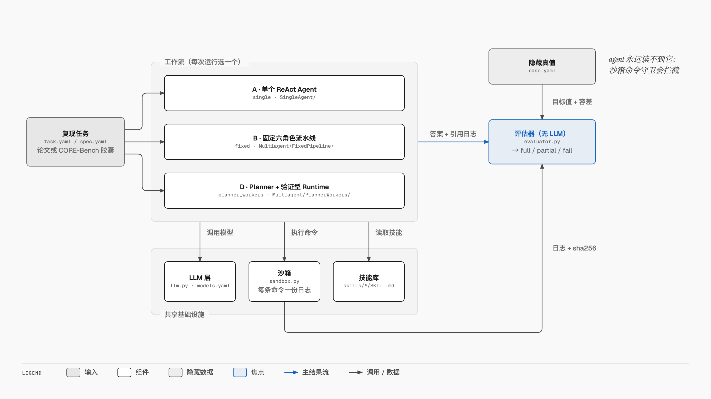
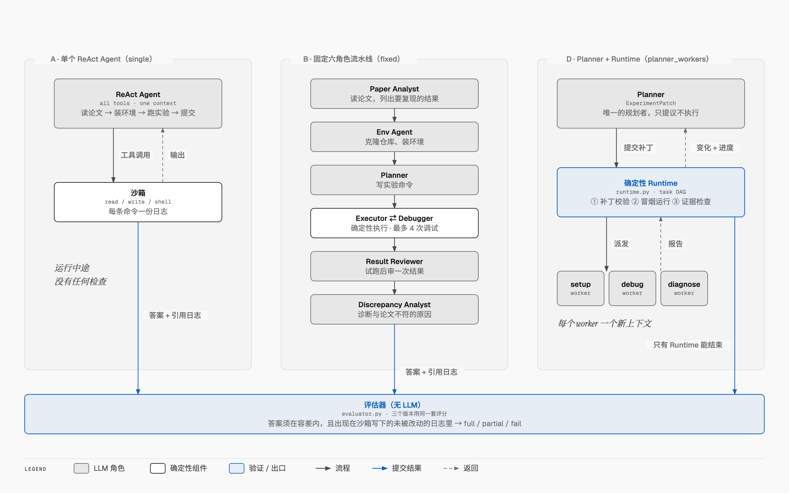

# Paper2Experiment: A Multi-Agent LLM System for Reproducing Engineering Research Papers

**English** · [中文](README.zh-CN.md)

## What is this?

Research papers report numbers ("our model reaches 92.5% accuracy"), but checking whether those numbers hold up
means a person has to read the paper, clone the code, fix the environment, run the experiments and compare the
results. That takes days per paper.

Paper2Experiment hands this job to LLM agents. Given a paper and its official code, the agents:

1. read the paper and work out which results need to be reproduced;
2. set up the environment and run the experiments in a sandbox;
3. report the value they measured for each result, together with the log that proves it, and explain why if it does
   not match the paper.

A deterministic evaluator then scores the run against hidden ground truth. No LLM acts as judge, so a run cannot
pass by sounding convincing: an answer counts only if it is within tolerance and appears in a log the sandbox wrote
itself.

The research question is **which agent architecture does this best**. The project builds three workflow designs (A,
B, D) and runs them on the same tasks, with the same sandbox, models, skill library and evaluator, so that the
architecture is the only thing that differs.

## Architecture



The system is built from five parts:

- **Task.** A reproduction task describes what to reproduce, either as a CORE-Bench capsule or as a paper case. It
  is converted into one shared format, the ReproSpec, so every workflow reads tasks the same way.
- **Workflow.** Each run uses one of three workflows (A, B or D), compared below.
- **Shared infrastructure.** All three workflows use the same LLM layer, sandbox and skill library:
  - *LLM layer:* Anthropic and OpenAI models, with cost tracking.
  - *Sandbox:* runs every command in an isolated workspace and writes one log per command, with a sha256 hash.
  - *Skill library:* reusable know-how the agents can read, such as setting up R or running notebooks.
- **Hidden ground truth.** The target values and tolerances are stored in `case.yaml`. The sandbox's command guard
  blocks the agents from reading it.
- **Evaluator.** It compares each answer with the ground truth and checks the logs, without using an LLM, then gives
  each run a verdict of full, partial or fail.

## The three workflows



| | Workflow | Who plans | Who checks the work during a run | Contexts |
|---|---|---|---|---|
| **A** [SingleAgent](SingleAgent/) | `single` | one ReAct agent that holds every tool | nobody: only the evaluator, at the end | one |
| **B** [FixedPipeline](Multiagent/FixedPipeline/) | `fixed` | code: six LLM roles in a fixed order | a Result Reviewer, once after a pilot run | one per role |
| **D** [PlannerWorkers](Multiagent/PlannerWorkers/) | `planner_workers` | one LLM Planner that edits a task graph | a deterministic runtime with three gates; only the runtime can end a run | Planner + one fresh worker per agent task |

- **A, the baseline.** A single agent does everything in one conversation: it reads the paper, installs the
  environment, runs the experiments and submits. It is simple and cheap, but nothing catches its mistakes until the
  run is scored.
- **B, a division of labour fixed in code.** Six specialised roles run in a fixed order: Paper Analyst → Env Agent →
  Planner → Executor ⇄ Debugger → Result Reviewer → Discrepancy Analyst. Each role sees only its own tools and has
  its own budget. Because the routing is fixed in code, no role has an overview: a mistake made early is often found
  only at the end.
- **D, an LLM that plans and code that verifies.** One Planner proposes changes to a task graph, and a deterministic
  runtime applies and runs them. The runtime checks every plan, runs a cut-down smoke version of each command first,
  and checks the evidence in the full run's log. Setup, debugging and diagnosis go to worker sub-agents, each with a
  clean context. Only the runtime can end a run.

Versions C (D without workers) and C- (C without gates) were tried in the first development round. They remain only
as ablation switches in D's code (`PlannerRuntimeWorkflow(ctx, gates=..., workers=...)`).

## Results

**CORE-Bench test set, Hard level.** The test set has 30 CPU tasks with 46 questions; 33 of the questions need
reading a figure. The model was Haiku55 and the skill library was v5, frozen before the run. Each task and workflow
pair ran once, with a budget of $5 per run. Full report:
[Base/runs/reports/cb_test_summary.md](Base/runs/reports/cb_test_summary.md).

| Workflow | Fully correct | 95% CI (Wilson) | HAL rule | Questions correct | Mean cost / run |
|---|---|---|---|---|---|
| A `single` | 29/30 (97%) | 83–99% | 24/30 | 44/46 | $0.013 |
| B `fixed` | 28/30 (93%) | 79–98% | 25/30 | 43/46 | $0.017 |
| D `planner_workers` | 26/30 (87%) | 70–95% | 22/30 | 40/46 | $0.025 |

None of the paired differences is significant (exact McNemar test, p ≥ 0.25). A scores highest at the lowest cost.
Our rule is stricter than HAL's in one way, since an answer must also be proven to come from the run itself, and
more lenient in another, since it accepts unrounded answers in line with the v1.1 fixes. Both sets of numbers are
reported. One of D's failures was an evaluator bug (an unhandled `KeyError` in the patch check), which has since been
fixed and covered by a regression test.

**CORE-Bench dev set, round 3.** This round has 42 scored tasks and three groups of 135 runs each. Summary:
[Base/runs/reports/cb_dev_round3_summary.md](Base/runs/reports/cb_dev_round3_summary.md).

| Group | A | B | D |
|---|---|---|---|
| Haiku55, skills v5 | 32 (76%) | 33 (79%) | 35 (83%) |
| Sonnet55, skills v5 | 31 (74%) | 33 (79%) | 36 (86%) |
| Haiku55, skills off | 31 (74%) | 33 (79%) | 31 (74%) |

What the results say:

- **No architecture wins clearly.** D leads on the dev set with skills on, but not significantly (p > 0.1), and is
  last on the test set. At this sample size, the three designs cannot be told apart.
- **The larger model buys nothing here.** Sonnet55 costs 7.6× as much as Haiku55 and reaches exactly the same total,
  100 fully correct runs in each group. The bottleneck is getting environments installed and programs to finish, not
  model capability.
- **The skill library mainly helps D.** With skills off, D drops 4 tasks and the three workflows tie.

## How a run is kept honest

- **Sandbox.** Each run gets its own workspace outside the project, with timeouts, API keys removed from the
  environment, and a guard that blocks access to the ground truth. See
  [Base/README.md](Base/README.md#sandbox-limits) for its limits.
- **Evidence.** Every answer must cite a log. The evaluator accepts a log only if the sandbox wrote it and it is
  unchanged since; this is checked by sha256. For a figure question, viewing an image that this run generated also
  counts as proof.
- **Pre-registered tolerance.** The tolerance rule is stated in the agents' brief, but the target values stay hidden.
  The rule combines run-to-run noise, reported precision and floating-point error. Its full rationale is in the
  docstring of [Base/p2e/corebench.py](Base/p2e/corebench.py).
- **Diagnosis.** When a value does not match, the agents write a `discrepancy_report.json` with a root-cause category
  and the evidence for it. The evaluator grades it on detection, false success and attribution.
- **Frozen skills.** The [skill library](skills/) grows round by round from development runs (digest → curator →
  leakage check → new version). It is frozen before any test run.

## Getting started

**Requirements:** Python 3.11 and [uv](https://docs.astral.sh/uv/). The demo frontend also needs Node.js.

```bash
uv venv --python 3.11.16 .venv                  # versions pinned in Base/uv.lock
(cd Base && uv export --frozen --extra dev --no-hashes --no-emit-project) | uv pip sync --python .venv/bin/python -
uv pip install --python .venv/bin/python -e "Base[dev]" --no-deps
cp Base/.env.example Base/.env                  # then fill in ANTHROPIC_API_KEY and/or OPENAI_API_KEY
.venv/bin/python -m pytest                      # offline tests of Base and every version (no API calls)
```

Model profiles (`haiku55`, `sonnet55`, `luna`, `sol`, ...) are defined in [Base/models.yaml](Base/models.yaml).
Settings, budgets, the evaluator and the sandbox are described in [Base/README.md](Base/README.md).

### Try the demo

The demo is a chat interface. Describe what to reproduce, for example by giving a GitHub repository and the
results you want checked, then pick a workflow and a model. The demo shows a live graph of the agents at work, and at
the end compares each answer with the value the paper reports.

```bash
cd Base/demo-web && npm install && npm run build && cd ../..   # once, and after frontend changes
.venv/bin/p2e demo serve                                       # http://127.0.0.1:8780
```

### Command reference

```bash
# CORE-Bench
.venv/bin/p2e corebench overview                # tasks and how our tolerance grades them
.venv/bin/p2e corebench run downloaded --split dev --workflow single fixed planner_workers --model haiku55 --update-skills
.venv/bin/p2e corebench report --split test     # summary report of finished runs

# supplementary paper set
.venv/bin/p2e run --case <v4 case> --workflow single fixed planner_workers --model haiku55
.venv/bin/p2e resume Base/runs/<run_dir>        # continue an interrupted paper run of B or D

# skill library
.venv/bin/p2e skills status | update <run dirs> | freeze "<reason>"

# results and UIs
.venv/bin/p2e table                             # all runs so far
.venv/bin/p2e serve                             # web UI: live view of any run, workflow comparison
.venv/bin/p2e demo serve                        # demo chat UI
```

## Repository layout

```
Base/                         shared infrastructure (package p2e), benchmark cases, shared tests
  p2e/sandbox.py              per-run workspace, timeouts, scrubbed env, command guard, one log per command (+ sha256)
  p2e/llm.py                  agent loop as a LangGraph subgraph; every model-visible message is recorded in the trace
  p2e/models.py, models.yaml  model profiles (Anthropic, OpenAI, OpenAI-compatible endpoints), tiered pricing
  p2e/runtime.py              task DAG, three verification gates, event-driven wakes, stall counter, finish gate (D)
  p2e/skills.py               skill library shared by every agent (read_skill tool)
  p2e/corebench.py, spec.py   CORE-Bench adapter (dev/test splits), tolerance rule, the ReproSpec task format
  p2e/runner.py, evaluator.py run setup, deterministic executor, objective scoring (tolerance + log evidence)
  p2e/versions.py             discovers the version folders below; `p2e run --workflow <name>`
  p2e/demo.py, web/           demo backend (prompt -> spec -> run -> compare) and the web UIs
  demo-web/                   demo frontend (Vite + React)
  benchmark/<case>/           task.yaml (what agents see), case.yaml (hidden ground truth)
  runs/reports/               result reports of the CORE-Bench rounds
SingleAgent/                  A
Multiagent/FixedPipeline/     B
Multiagent/PlannerWorkers/    D (holds the shared Planner + runtime code; switches gates/workers for ablations)
skills/                       the skill library: <name>/SKILL.md, CHANGELOG.md, history/, library.yaml
docs/diagrams/, docs/images/  architecture diagrams (HTML sources + generator, PNG exports)
conftest.py, pytest.ini       fixtures and test paths for all folders
```

Each version folder has a `workflow.py` (defines `NAME`, `DESCRIPTION`, `run(ctx)`), a README and its own tests.

## Status

- **Done:** all three workflows, the evaluator, the skill library (v5, frozen), three CORE-Bench dev rounds, the
  CORE-Bench test run, and the demo UI.
- **Open:** the test run was single-shot, so repeated runs would tighten the confidence intervals. The supplementary
  v4 paper set (20 self-built papers in `Base/benchmark/v4`) was last run in development round 1 (2026-10-17),
  before the final versions.

Project history before v4 (EE6008, single agent vs fixed pipeline): [Base/docs/OVERVIEW.en.md](Base/docs/OVERVIEW.en.md)
· [Base/docs/OVERVIEW.zh.md](Base/docs/OVERVIEW.zh.md).
