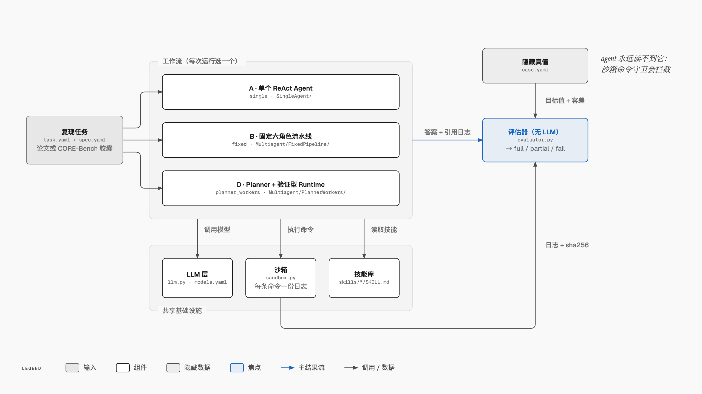
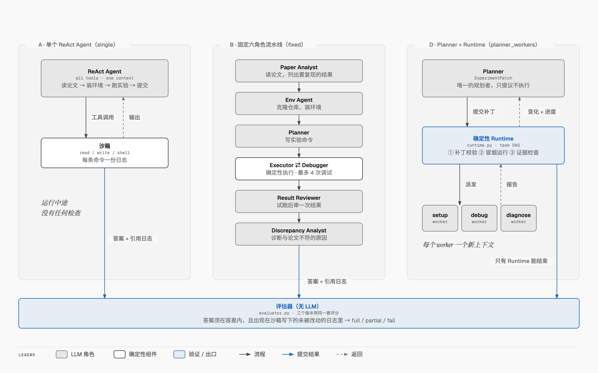

# Paper2Experiment：用多智能体 LLM 系统复现工程类研究论文

[English](README.md) · **中文**

## 这是什么

论文里会报告各种数字，比如"我们的模型准确率达到 92.5%"。要验证这些数字站不站得住，得有人读论文、拉代码、修环境、跑实验，再拿结果和论文对比。一篇论文往往要花好几天。

Paper2Experiment 把这件事交给 LLM agent 来做。给定一篇论文和它的官方代码，agent 会：

1. 读论文，弄清楚要复现哪些结果；
2. 在沙箱里装好环境、跑实验；
3. 报告每个结果测出来的数值，附上能证明它的日志；如果和论文对不上，还要解释原因。

之后由一个确定性的评估器，拿隐藏的标准答案给这次运行打分。全程不用 LLM 当裁判，所以 agent 没法靠"说得像那么回事"过关：一个答案只有落在容差范围内，并且确实出现在沙箱自己写下的日志里，才算数。

这个项目要回答的问题是：**哪种 agent 架构最适合做这件事。** 我们设计了三种工作流（A、B、D），让它们在同样的任务上跑，并且用同一个沙箱、同一批模型、同一个技能库和同一个评估器。这样三者之间唯一的区别就是架构本身。

## 整体架构



整个系统由五部分组成：

- **复现任务**：说明要复现什么，可以是一个 CORE-Bench 胶囊，也可以是一篇自建论文。所有任务都会先转换成统一的格式 ReproSpec，这样三种工作流读任务的方式完全一样。
- **工作流**：每次运行选三种工作流中的一种（A、B 或 D），下一节详细对比。
- **共享基础设施**：三种工作流共用同一套 LLM 层、沙箱和技能库。
  - *LLM 层*：接入 Anthropic 和 OpenAI 的模型，并记录花费。
  - *沙箱*：每条命令都在隔离的工作区里执行，每条命令单独写一份日志，并记下 sha256。
  - *技能库*：agent 可以随时查阅的经验，比如怎么装 R 环境、怎么跑 notebook。
- **隐藏真值**：目标值和容差存在 `case.yaml` 里。沙箱的命令守卫会拦住 agent，不让它读这个文件。
- **评估器**：把答案和真值对比，并检查日志，整个过程不用 LLM。最后给出 full（全对）、partial（部分对）或 fail（失败）的判定。

## 三种工作流



| | 工作流 | 谁来规划 | 运行中途谁来检查 | 上下文 |
|---|---|---|---|---|
| **A** [SingleAgent](SingleAgent/) | `single` | 一个 ReAct agent，持有全部工具 | 没有人，只有评估器在最后检查 | 一个 |
| **B** [FixedPipeline](Multiagent/FixedPipeline/) | `fixed` | 代码：六个 LLM 角色按固定顺序工作 | Result Reviewer，在试跑之后检查一次 | 每个角色一个 |
| **D** [PlannerWorkers](Multiagent/PlannerWorkers/) | `planner_workers` | 一个 LLM Planner，负责修改任务图 | 确定性 Runtime 设三道关卡，并且只有它能结束运行 | Planner 一个，每个 agent 任务另开一个新 worker |

**A：基线。** 一个 agent 在同一段对话里包办所有事情：读论文、装环境、跑实验、提交结果。它结构简单、花费低，但中途犯了错没有人发现，要等到最后打分才会暴露。

**B：分工写死在代码里。** 六个专职角色按固定顺序接力：Paper Analyst → Env Agent → Planner → Executor ⇄ Debugger → Result Reviewer → Discrepancy Analyst。每个角色只能用自己需要的工具，也有自己的预算。问题在于顺序是代码定死的，没有哪个角色能看到全局，所以前面环节犯的错，经常要到最后才被发现。

**D：LLM 负责规划，代码负责验证。** Planner 只提出对任务图的修改，由确定性的 Runtime 来应用和执行。Runtime 设了三道关卡：先检查每份计划；再让每条命令先跑一个缩短版的冒烟测试；最后检查完整运行的日志里有没有证据。装环境、调试、诊断这类工作交给 worker 子 agent，每个 worker 都从一个干净的上下文开始。只有 Runtime 能结束一次运行。

另外，C（去掉 worker 的 D）和 C-（再去掉关卡的 C）在第一轮开发时试过，现在只作为 D 代码里的消融开关保留，即 `PlannerRuntimeWorkflow(ctx, gates=..., workers=...)`。它们不参加正式比较。

## 实验结果

### CORE-Bench 测试集（Hard 级）

测试集共 30 道只需 CPU 的题、46 个问题，其中 33 个要看图才能回答。模型用 Haiku55，技能库用 v5，开跑前已经冻结。每个"题目 × 工作流"组合只跑一次，每次预算 $5。完整报告见 [Base/runs/reports/cb_test_summary.md](Base/runs/reports/cb_test_summary.md)。

| 工作流 | 全对 | 95% 置信区间（Wilson） | HAL 规则 | 问题正确数 | 平均每次花费 |
|---|---|---|---|---|---|
| A `single` | 29/30（97%） | 83–99% | 24/30 | 44/46 | $0.013 |
| B `fixed` | 28/30（93%） | 79–98% | 25/30 | 43/46 | $0.017 |
| D `planner_workers` | 26/30（87%） | 70–95% | 22/30 | 40/46 | $0.025 |

三者两两比较都没有显著差别（精确 McNemar 检验，p ≥ 0.25）。A 的分数最高，花费也最低。

我们的评分规则和原版 HAL 规则有两点不同：

- 更严的一面：答案除了要对，还要能证明确实是这次运行算出来的。
- 更宽的一面：接受没有四舍五入的答案，这和 CORE-Bench v1.1 的修正一致。

所以两套数字都列出来了。D 的失败里有一次是评估框架本身的 bug（补丁检查里一个没处理的 `KeyError`），已经修复，并补了回归测试。

### CORE-Bench 开发集（第三轮）

这一轮共 42 道计分题，分三组，每组 135 次运行。总结见 [Base/runs/reports/cb_dev_round3_summary.md](Base/runs/reports/cb_dev_round3_summary.md)。

| 组别 | A | B | D |
|---|---|---|---|
| Haiku55，技能库 v5 | 32（76%） | 33（79%） | 35（83%） |
| Sonnet55，技能库 v5 | 31（74%） | 33（79%） | 36（86%） |
| Haiku55，关闭技能库 | 31（74%） | 33（79%） | 31（74%） |

### 结论

**没有哪种架构明显更好。** 开着技能库时，D 在开发集上排第一，但差距不显著（p > 0.1）；到了测试集，D 反而排最后。按现在的样本量，分不出三种设计的高下。

**换更大的模型没有带来提升。** Sonnet55 的花费是 Haiku55 的 7.6 倍，总成绩却一模一样，两组都是 100 次全对。这说明瓶颈在于环境能不能装起来、程序能不能跑完，而不在模型能力。

**技能库主要帮的是 D。** 关掉技能库后，D 少做对了 4 道题，三种工作流打成平手。

## 怎样保证结果可信

**沙箱。** 每次运行都在项目目录之外有自己独立的工作区，设有超时，环境变量里的 API key 会被清掉，还有命令守卫拦截对真值的访问。沙箱的局限见 [Base/README.md](Base/README.md#sandbox-limits)。

**证据。** 每个答案都必须引用一份日志。评估器只认沙箱自己写下、并且之后没被改动过的日志，靠 sha256 核对。如果是看图题，"这次运行生成了一张图，agent 也确实查看过它"同样算作证据。

**事先公布的容差。** 容差规则会写在给 agent 的任务说明里，但目标值始终保密。这条规则综合考虑了三种正当的误差来源：多次运行之间的随机波动、论文报告的精度、浮点误差。完整的推导和依据写在 [Base/p2e/corebench.py](Base/p2e/corebench.py) 的 docstring 里。

**失败诊断。** 如果数值对不上，agent 要写一份 `discrepancy_report.json`，给出根因类别和支撑证据。评估器会从三个方面给它打分：有没有发现问题（detection）、有没有把错的说成对的（false success）、原因归对了没有（attribution）。

**冻结的技能库。** [技能库](skills/)每轮从开发集的运行中提炼经验来升级，流程是摘要 → 策展 → 泄漏检查 → 发布新版。跑测试集之前，技能库会被冻结。

## 快速上手

**环境要求：** Python 3.11 和 [uv](https://docs.astral.sh/uv/)。如果要跑 demo 前端，还需要 Node.js。

```bash
uv venv --python 3.11.16 .venv                  # 依赖版本锁定在 Base/uv.lock
(cd Base && uv export --frozen --extra dev --no-hashes --no-emit-project) | uv pip sync --python .venv/bin/python -
uv pip install --python .venv/bin/python -e "Base[dev]" --no-deps
cp Base/.env.example Base/.env                  # 然后填入 ANTHROPIC_API_KEY 和/或 OPENAI_API_KEY
.venv/bin/python -m pytest                      # 离线测试，覆盖 Base 和所有版本，不调用 API
```

模型配置（`haiku55`、`sonnet55`、`luna`、`sol` 等）定义在 [Base/models.yaml](Base/models.yaml)。各项设置、预算、评估器和沙箱的详细说明见 [Base/README.md](Base/README.md)。

### 试试 demo

demo 是一个聊天界面。你告诉它要复现什么，比如给一个 GitHub 仓库地址，再说明想验证哪些结果，然后选好工作流和模型。运行过程中，页面会实时显示各个 agent 在做什么；跑完后，会把每个答案和论文里报告的数值放在一起对比。

```bash
cd Base/demo-web && npm install && npm run build && cd ../..   # 首次运行，以及每次改完前端后执行
.venv/bin/p2e demo serve                                       # http://127.0.0.1:8780
```

### 常用命令

```bash
# CORE-Bench
.venv/bin/p2e corebench overview                # 查看题目，以及我们的容差规则怎么判分
.venv/bin/p2e corebench run downloaded --split dev --workflow single fixed planner_workers --model haiku55 --update-skills
.venv/bin/p2e corebench report --split test     # 汇总已完成运行的结果

# 补充论文集
.venv/bin/p2e run --case <v4 case> --workflow single fixed planner_workers --model haiku55
.venv/bin/p2e resume Base/runs/<run_dir>        # 继续一次中断了的 B 或 D 论文运行

# 技能库
.venv/bin/p2e skills status | update <run dirs> | freeze "<reason>"

# 结果和界面
.venv/bin/p2e table                             # 列出到目前为止的所有运行
.venv/bin/p2e serve                             # 网页界面：实时查看任意运行，对比各工作流
.venv/bin/p2e demo serve                        # demo 聊天界面
```

## 目录结构

```
Base/                         共享基础设施（p2e 包）、基准任务、共享测试
  p2e/sandbox.py              每次运行独立的工作区、超时、清理环境变量、命令守卫、每条命令一份日志（附 sha256）
  p2e/llm.py                  agent 循环（LangGraph 子图）；模型看到的每条消息都记进 trace
  p2e/models.py, models.yaml  模型配置（Anthropic、OpenAI 及兼容 OpenAI 的接口）、分档计价
  p2e/runtime.py              任务 DAG、三道验证关卡、事件驱动唤醒、停滞计数、结束关卡（D 的底座）
  p2e/skills.py               所有 agent 共用的技能库（read_skill 工具）
  p2e/corebench.py, spec.py   CORE-Bench 适配（dev/test 划分）、容差规则、ReproSpec 任务格式
  p2e/runner.py, evaluator.py 运行准备、确定性执行器、客观评分（容差 + 日志证据）
  p2e/versions.py             发现下面各个版本的目录；`p2e run --workflow <name>`
  p2e/demo.py, web/           demo 后端（prompt → spec → 运行 → 对比）和网页界面
  demo-web/                   demo 前端（Vite + React）
  benchmark/<case>/           task.yaml（agent 能看到的）、case.yaml（隐藏真值）
  runs/reports/               CORE-Bench 各轮的结果报告
SingleAgent/                  A
Multiagent/FixedPipeline/     B
Multiagent/PlannerWorkers/    D（包含共用的 Planner 和 runtime 代码；可切换 gates/workers 做消融）
skills/                       技能库：<name>/SKILL.md、CHANGELOG.md、history/、library.yaml
docs/diagrams/, docs/images/  架构图（HTML 源文件 + 生成脚本，以及导出的 PNG）
conftest.py, pytest.ini       所有目录共用的测试夹具和测试路径
```

每个版本目录里都有一个 `workflow.py`（定义 `NAME`、`DESCRIPTION`、`run(ctx)`）、一份 README 和它自己的测试。

## 项目状态

**已完成：** 三种工作流、评估器、技能库（v5，已冻结）、三轮 CORE-Bench 开发集实验、CORE-Bench 测试集实验，以及 demo 界面。

**待完成：** 测试集只跑了一次，多跑几次可以收窄置信区间。补充用的 v4 论文集（`Base/benchmark/v4` 里自建的 20 篇论文）最后一次运行是在第一轮开发（2026-10-17），当时还不是最终版本。

v4 之前的项目历史（EE6008，单 agent 与固定流水线的对比）：[Base/docs/OVERVIEW.en.md](Base/docs/OVERVIEW.en.md) · [Base/docs/OVERVIEW.zh.md](Base/docs/OVERVIEW.zh.md)。
